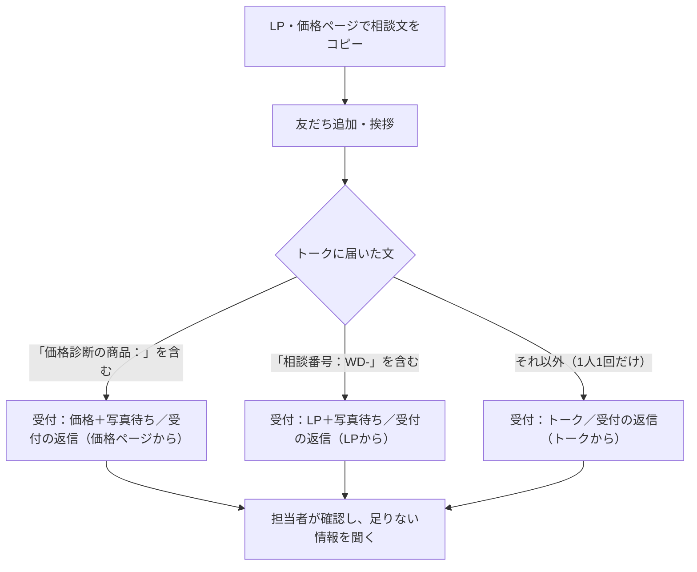

# plus wood deck｜UTAGE の設定（LINE 受付）

更新日：2026-10-09。UTAGE の API で読み直した結果をもとに書いています。管理画面で設定を変えたら、この表も直してください。

この設定は、plusカーポートで 2026-09-30 に実機テストに合格した受付の型を、ウッドデッキ用に写したものです。旧指示書（[utage-line-build-spec.md](utage-line-build-spec.md)）の「答えを読んで次の質問を変える」会話は、UTAGE の自動応答（決まった言葉が含まれるかだけで分ける）では作れないため、採用していません。

## 1. いまの状態

| 部品 | 状態 | お客さまに届くか |
| --- | --- | --- |
| 挨拶（シナリオ「挨拶グループ」） | 2026-08-07 の旧文面のまま配信中 | 届く（友だち追加時） |
| ラベル 7個 | 作成済み | 自動応答が無いので、まだ誰にも付かない |
| 受付シナリオ 3つ＋返信文 3通 | 返信文は配信予約済み | 登録者0人。自動応答が無いので届かない |
| 配信アクション 3つ | 作成済み | 自動応答から呼ばれるまで動かない |
| 再案内 3通 | 下書き（未承認・停止中） | 届かない |
| 自動応答 | **0件** | 文面の承認後に入れる |
| 登録経路「LP（ウッドデッキ専門店）」 | 作成済み。`dist/site-config.js` の `lineUrl` の `mtid` | LP から来た友だちを区別して数える |
| リッチメニュー | 無し | 画像（`dist/assets/line/plus-wooddeck-rich-menu.png`）の登録は管理画面でしかできない |
| LIFF | 無し | `liffId` が空。相談画面はコピー方式で動く |

Webhook は UTAGE が使っています。別の URL に変えないでください。

## 2. 受付の流れ

LP・価格ページ・相談画面（`/line/consult/`）が作る相談文は、どれも先頭が `相談番号：WD-` です（`dist/assets/consultation-state.js` の `getConsultationId` は、保存が使えないときも `WD-` で始まる番号を返します）。価格ページで商品を選んでいると、本文に `価格診断の商品：` が入ります。**この2つの言葉は自動応答のキーワードなので、LP 側で形を変えるときは、この表と UTAGE の自動応答も一緒に直してください。**

## 3. 自動応答（承認後、この順で作る）

UTAGE の自動応答は、一覧の上から順に評価され、最初に一致した1件だけが動きます。API で作ると一覧の末尾に足されるので、①→②→③の順に作ります。

| 順 | 種類 | キーワード（部分一致） | 呼ぶ配信アクション |
| --- | --- | --- | --- |
| ① | キーワード | `価格診断の商品：` | 受付：価格ページ |
| ② | キーワード | `相談番号：WD-` | 受付：LP（写真あとから） |
| ③ | 一律応答 | （どれにも一致しない文） | 受付：トーク（1人1回） |

自動応答は文字のメッセージにしか反応しません。写真が届いても何も動きません。

## 4. 配信アクション

| 名前 | 付けるラベル | 登録するシナリオ |
| --- | --- | --- |
| 受付：価格ページ | 相談受付：価格、写真待ち | 相談受付｜価格ページから（何度でも）、写真待ちの再案内（1回だけ） |
| 受付：LP（写真あとから） | 相談受付：LP、写真待ち | 相談受付｜LPから（何度でも）、写真待ちの再案内（1回だけ） |
| 受付：トーク（1人1回） | 相談受付：トーク | 相談受付｜トークから（1回だけ） |

LP には写真の送り口が無いため、カーポートにある「受付：フォーム（写真あり）」に当たるものは作っていません。

## 5. ラベル

| ラベル | 付け方 | 意味 |
| --- | --- | --- |
| 相談受付：LP | 自動 | LP 本文・相談画面から相談文を送った |
| 相談受付：価格 | 自動 | 価格ページで商品を選んで相談文を送った |
| 相談受付：トーク | 自動 | 相談文以外のメッセージを送った |
| 写真待ち | 自動で付き、**担当者が外す** | 写真がまだ届いていない |
| 有人対応中 | 担当者 | 担当者がやり取りしている。トークからの受付の返信と再案内を止める |
| 施工店へ引き継ぎ済み | 担当者 | 同意をとって施工対応店へ渡した。再案内を止める |
| 対応エリア外 | 担当者 | 九州・東海・関東の外 |

問い合わせの件数は「相談受付：LP／価格／トーク のどれかが付いた人数」で数えます。友だち追加の数やボタンのクリック数は含めません。

## 6. シナリオとメッセージ

| シナリオ | メッセージ | 状態 | 配信条件 |
| --- | --- | --- | --- |
| 挨拶グループ | LINE登録後メッセージ（旧文面） | 配信中 | — |
| 挨拶グループ | 翌日12時：まだ相談していない人へのご案内 | 下書き・未承認 | 相談受付ラベル（LP／価格／トーク）が無い人 |
| 相談受付｜LPから | 受付の返信（LPから）2吹き出し | 配信予約・即時 | なし |
| 相談受付｜価格ページから | 受付の返信（価格ページから）2吹き出し | 配信予約・即時 | なし |
| 相談受付｜トークから | 受付の返信（トークから・1人1回）文＋ボタン | 配信予約・即時 | 相談受付：LP／価格、有人対応中が無い人 |
| 写真待ちの再案内（未承認・停止中） | 再案内1（翌日10時）、再案内2（7日後10時） | 下書き・未承認 | 写真待ちが有り、有人対応中・施工店へ引き継ぎ済みが無い人 |

ボタン「相談画面を開く」の行き先は `https://michishirube-consulting.github.io/plus-wood-deck-lp/line/consult/` です。LIFF ができたら LIFF の URL に差し替えます。

## 7. 公開の手順

1. 挨拶の差し替え案と受付の返信3通の文面を、運営者が承認する（挨拶の旧文面にある「外構デザイナー歴15年」は事実確認が取れていないため、案から外している）
2. 挨拶を差し替える
3. 自動応答を①②③の順に作る
4. 運営者本人の LINE で3通り送る：LP の相談文を貼り付け／価格ページの相談文／自由な文を2回。返信が1通ずつ届き、ラベルが付き、2回目の自由文に返信が無いことを API で確かめる
5. テストで付いたラベルを本人のアカウントから外す

自動応答と挨拶は、入れた瞬間から実際のお客さまに届きます。必ず 1 の承認のあとに行ってください。

## 8. 公開前に確かめること（未確認）

| 項目 | 理由 |
| --- | --- |
| 再案内を下書きのまま登録された人に、あとで配信予約へ切り替えるとまとめて届くか | 自動応答を入れると、再案内シナリオへの登録は下書きのままでも始まる |
| 「写真待ち」を外す担当者の手順 | 写真が届いても自動では外れない。外し忘れると、写真を送った人に「写真のご準備は」が届く |
| LINE 内ブラウザで相談画面を開き、コピーして LINE に戻れるか | 実機では試していない |
| LINE 公式アカウント側の自動返信 | UTAGE の返信と二重になるおそれ。API からは見えない |
| `lineId` を入れる場合の計測 | 入れると LP は友だち追加リンクではなく「文面入りでトークを開く」リンクを使うため、登録経路「LP（ウッドデッキ専門店）」を通らない |
| Channel secret の再発行 | 過去のスクリーンショットに写っていた。再発行したら UTAGE へも同時に貼り替える（片方だけだと受信が止まる） |
